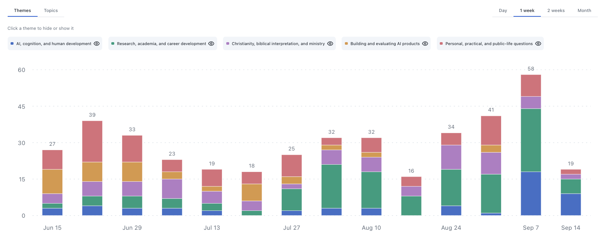
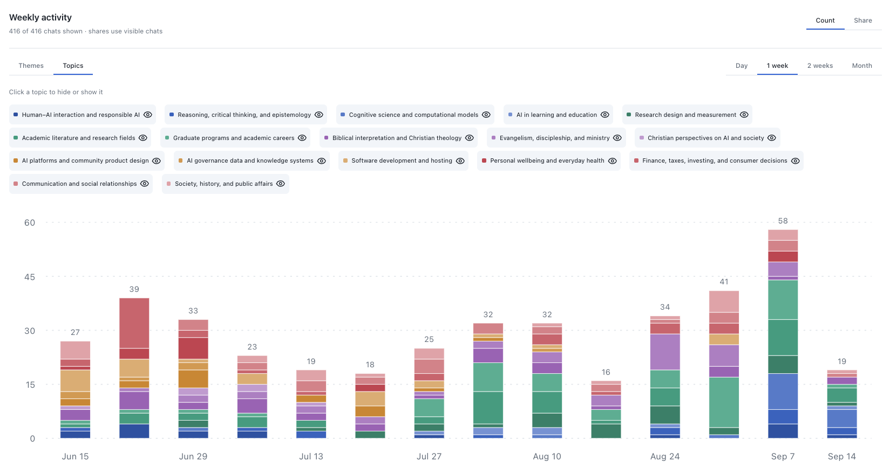
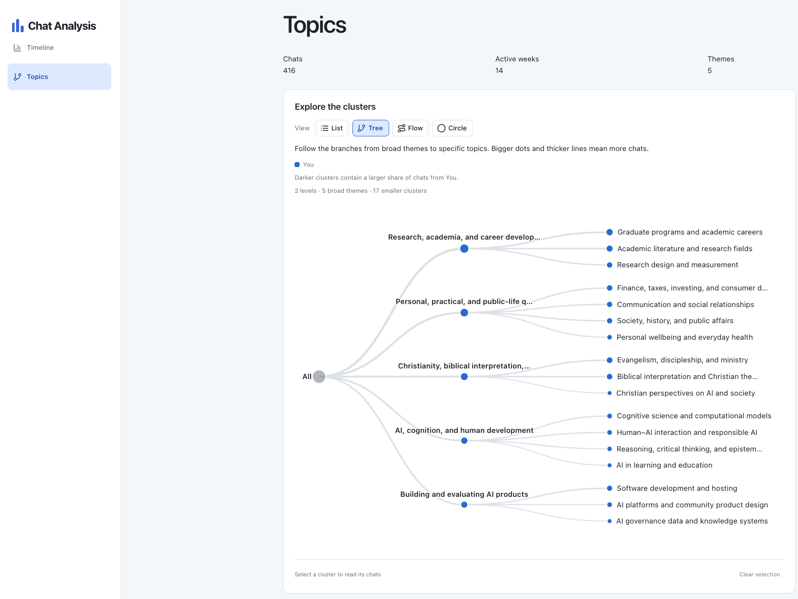
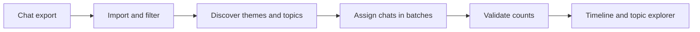

<div align="center">


# Chat Analysis

**See how your questions to AI change over time, and which ones keep coming back.**

[](https://github.com/YXGuan/chat_analysis/actions/workflows/pytest.yml)
[](https://github.com/YXGuan/chat_analysis/actions/workflows/privacy.yml)
[](LICENSE)
[](pyproject.toml)
[](ui/package.json)
[](https://heroui.com)

[Quick start](#quick-start) ·
[Import your history](#import-your-chatgpt-history) ·
[How it works](#how-it-works) ·
[Example data](#example-datasets) ·
[Development](#development)

<br />



</div>

## About

Chat Analysis turns a long chat history into a timeline you can explore. It sorts
every conversation into broad **themes** and more specific **topics**. Then it
shows how those topics rise, fall, and return over days, weeks, and months.

You can import your own ChatGPT history or start with the included
[WildChat](https://huggingface.co/datasets/allenai/WildChat-4.8M) samples.
Chat Analysis builds on [Kura](https://github.com/jxnl/kura), an open-source
take on [Anthropic's Clio](https://www.anthropic.com/research/clio).

## Features

- **Timelines at four scales.** Group activity by day, week, two weeks, or
  calendar month. Switch between chat counts and topic shares.
- **Two levels of detail.** Broad themes split into specific topics. Click any
  label to hide or show it.
- **Four cluster views.** Explore topics as a list, tree, flow, or nested circles.
- **Source chats one click away.** Click a bar segment or cluster to read the
  conversations behind it.
- **Change over time.** Compare each person's first and last four weeks to see
  what grew and what faded.
- **Your own history.** Import a ChatGPT export ZIP, folder, or JSON file from
  the app or the command line.
- **Private by default.** Imports stay in an ignored local folder. Browsing saved
  data makes no model calls.
- **Checked results.** Every model batch must account for every chat, and counts
  must match at both levels.

<table>
  <tr>
    <td width="50%" valign="top">
      
      <p align="center"><b>Topic timeline</b><br /><sub>Break each week into specific topics.</sub></p>
    </td>
    <td width="50%" valign="top">
      
      <p align="center"><b>Topic explorer</b><br /><sub>Follow broad themes down to specific topics.</sub></p>
    </td>
  </tr>
</table>

## Quick start

### Requirements

- [Python](https://www.python.org/) 3.10 or newer and [uv](https://docs.astral.sh/uv/)
- [Node.js](https://nodejs.org/) 20.11 or newer, with npm
- An OpenAI account that can sign in to Codex. You only need this to analyze new
  imports. The example data works without it.

### Install and run

From the repository root:

```bash
# 1. Install Python and UI dependencies
uv sync --group dev
npm --prefix ui ci

# 2. Install the project's own Codex CLI and sign in
npm run setup:codex
.local/tools/node_modules/.bin/codex login

# 3. Start the app
npm run dev
```

Open the localhost address that Vite prints. This command starts the UI and the
local import service on `127.0.0.1:8014`.

> [!TIP]
> The repo installs its own Codex CLI, pinned to **0.163.0**, without changing
> your system setup. If you already signed in to Codex on this computer, that
> login is reused.

<details>
<summary><b>Run a production build</b></summary>

<br />

```bash
npm run build
.venv/bin/python -m kura.cli.cli start-app
```

Then open <http://127.0.0.1:8014>. A static file server can show the public
examples, but uploads and private histories need the local service.

</details>

## Import your ChatGPT history

1. **Export your data.** In ChatGPT, go to **Settings → Data controls → Export data**.
2. **Open the importer.** Click **Import history** in the app header. Choose the
   export ZIP, the unzipped folder, `conversations.json`, or all of the
   `conversations-*.json` files. You can also type a path on this computer.
3. **Pick a time period.** Check the conversation count, then choose how much
   history to analyze. See the note below.
4. **Analyze.** Name the dataset and select **Analyze my history**. Progress is
   shown batch by batch. You can close the dialog while it works, and it
   reconnects if you reload the page.
5. **Explore.** When analysis finishes, open your timeline. Saved imports appear
   in the dataset selector.

The default period is the latest **three calendar months in the export**. It
counts back from your newest conversation, not from today, and includes the
boundary day. You can also choose one month, six months, one year, or all history.

> [!IMPORTANT]
> Readable user text is sent to OpenAI through your Codex login for analysis.
> These are hosted model calls, not on-device processing. Your exports, model
> results, and profiles are stored in the ignored `.local/kura/` folder, outside
> `ui/public/` and the built static files. Your original files are never changed.

### From the command line

```bash
.venv/bin/python -m kura.cli.cli import-history /path/to/chatgpt-export \
  --months 3 --name "My ChatGPT history"
```

| Option           | Default              | What it does                                         |
| ---------------- | -------------------- | ---------------------------------------------------- |
| `--months`       | `3`                  | Use the latest 1, 3, 6, or 12 months. Use `0` for all history. |
| `--name`         | `My ChatGPT history` | The name shown in the dataset selector.              |
| `--prepare-only` | off                  | Import and preview without contacting a model.       |
| `--data-dir`     | `.local/kura`        | The private folder where imports are stored.         |

There is no API key or provider to set up for the default workflow.

<details>
<summary><b>What the importer keeps and skips</b></summary>

<br />

- It follows the conversation branch you selected in ChatGPT. Other branches are
  skipped.
- It keeps visible user and assistant text. **The model reads user messages only.**
- It skips images, audio, chats with only attachments, and hidden reasoning. The
  preview tells you how many chats have no readable user text.
- Original source IDs and the full kept text stay available in the conversation
  reader.
- If the model fails, your import stays safe. A retry reuses finished batches
  for the same source and model.

</details>

## Using the explorer

**Timeline.** Switch between broad themes and specific topics, and group by day,
one week, two weeks, or calendar month. Click a label to hide or show it, and use
**Show all** to bring everything back. Hiding a theme also hides its topics. Your
browser remembers what you hid for each dataset and your chosen grouping.

- **Counts** show how much activity there was.
- **Shares** compare the mix of visible topics.
- Empty periods stay on the chart, so gaps are easy to see.
- Click any segment to read the chats inside it.

**Topics.** Explore the clusters as a list, tree, flow, or nested circles. Source
conversations stay beside the cluster you select.

<details>
<summary><b>How "changes over time" is measured</b></summary>

<br />

- Changes compare each user's first and last four calendar weeks.
- Each of those two windows needs at least five chats, and the windows cannot
  overlap. Some research users have only a few days of data, so their changes
  are hidden.
- Each chat keeps the same category across every week.
- Counts, shares, changes, and source conversations use only visible chats. The
  original date range and the four-week windows stay fixed.
- The app's analysis dialog explains the rules for repeat topics and their limits.

</details>

## Example datasets

Two public sample sets come with the repo, so you can try the app right away.

| Dataset            | Chats | Users | GPT-6 Luna hierarchy         |
| ------------------ | ----: | ----: | ---------------------------- |
| Personal histories |   122 |     2 | 4 themes, 14 specific topics |
| Science & physics  |   120 |     3 | 5 themes, 12 specific topics |

- **Personal histories** keeps the original two users, picked because they have
  long histories.
- **Science & physics** uses the conversations from
  [`examples/temporal/reference-research/gpt-6-luna`](examples/temporal/reference-research/gpt-6-luna).

GPT-6 Luna analyzed both sets again from scratch, using only **user** messages.
The app does not reuse the earlier labels that were reviewed with an assistant,
or the original cluster assignments from the reference run.

## How it works



1. **Import.** Read the export, follow the selected branch, and keep readable text.
2. **Discover.** The first pass sees a short excerpt of every chat in the chosen
   period. It builds one fixed two-level hierarchy of themes and topics.
3. **Assign.** Later batches get the full user text. A schema limits answers to
   real topic IDs and short chat IDs.
4. **Validate.** Each batch must cover exactly its own chats. Final counts must
   match at both levels. Original IDs are restored before export.
5. **Explore.** The UI reads the saved results. Browsing makes no model calls.

<details>
<summary><b>Analysis model</b></summary>

<br />

By default, the repo runs **headless `codex exec` with `gpt-6-luna` at low
reasoning effort**.

- **Which Codex it uses:** `KURA_CODEX_BIN` comes first, then the project's own
  CLI, then your `PATH`.
- **How it runs:** short-lived runs in a read-only sandbox, with no web access and
  no model tools. Output is structured JSON, made in a clean temporary folder.
- **No silent fallback:** model and account errors are shown clearly. A
  different model is never swapped in.
- [`examples/local/run.py`](examples/local/run.py) also uses this adapter by
  default. The older OpenAI API pipeline needs `--engine api`.

The included samples were analyzed earlier by GPT-6 Luna agents inside a Codex
session. New imports use the checked, project-local headless CLI and record
`execution: local-codex-cli`.

</details>

<details>
<summary><b>Provenance and rebuilding the sample data</b></summary>

<br />

Raw model results are in [`data/analysis`](data/analysis). The UI's saved data is
in [`ui/public/data`](ui/public/data). It includes:

- the model and how it was run
- checksums for the input and the analysis
- every assignment, summary, and confidence score
- source chats and counts at both levels

Confidence scores come from the model and are not calibrated. Labels are
interpretations, and unclear cases include notes.

To rebuild the UI data from the saved Luna results without calling the model:

```bash
.venv/bin/python examples/temporal/codex_analysis.py \
  --input examples/temporal/sample/conversations.jsonl \
  --import-analysis data/analysis/personal.gpt-6-luna.json \
  --output ui/public/data/personal.json \
  --work-dir .cache/codex-analysis/personal

.venv/bin/python examples/temporal/codex_analysis.py \
  --input examples/temporal/reference-research/gpt-6-luna/conversations.jsonl \
  --import-analysis data/analysis/research.gpt-6-luna.json \
  --output ui/public/data/research.json \
  --work-dir .cache/codex-analysis/research
```

If you leave out `--import-analysis`, the script calls the headless adapter.
`--prepare-only` writes the prompt and schema without contacting a model. See
[Codex non-interactive mode](https://developers.openai.com/codex/noninteractive)
for details on structured output.

</details>

## Data sources and limits

The sample data comes from
[AllenAI WildChat-4.8M](https://huggingface.co/datasets/allenai/WildChat-4.8M),
under the [ODC-BY](https://opendatacommons.org/licenses/by/1-0/) license.

- **Users are estimates.** User groups combine hashed IP and browser details.
  They may merge people on a shared network or split one person into several.
- **Histories are partial.** The loader keeps the first eight messages of each
  chat and shortens each message to 2,000 characters.
- **Text may be sensitive.** Some chats may still contain personal details, even
  after the source's redaction.

The earlier [bar-chart prototype](examples/temporal/sample/report.html) and
[baseline notes](examples/temporal/README.md) are kept with their original
assistant-reviewed labels. They are separate from the new Luna analysis.

## Development

### Project layout

```text
kura/                  Python package: importer, analysis, CLI, and local server
  cli/                 Command-line app and API server
ui/                    React front end (Chat Analysis starts in ui/src/TemporalApp.tsx)
examples/temporal/     Sample conversations and the analysis script
data/analysis/         Raw GPT-6 Luna results for the sample sets
ui/public/data/        Saved data the UI loads
scripts/               Dev server launcher and publication checks
tests/                 Python tests
```

The interface uses [HeroUI v3](https://heroui.com) components and design tokens,
light and dark themes, and React Aria for interactions. HeroUI's React agent
skill and doc helpers live in
[`.agents/skills/heroui-react`](.agents/skills/heroui-react/SKILL.md).

### Tests and checks

```bash
.venv/bin/pytest tests/ -q     # Python tests
npm --prefix ui run build      # Type-check and build the UI
```

Model-output checks reject:

- missing, made-up, or duplicate chat assignments
- broken hierarchies or out-of-range confidence scores
- missing or duplicate users
- counts or checksums that do not match at either level

### Before you publish

Run `python3 scripts/check_publication.py`, and install the commit hooks with
`.venv/bin/pre-commit install`. The privacy workflow scans files and Git history
with Gitleaks, including a rule for Logfire credentials. Private exports, caches,
credentials, databases, and generated reports are ignored by Git. The public
WildChat samples are included on purpose. See the
[publication audit](docs/publication-audit.md) for the full scope and findings.

## Acknowledgments

- **[Kura](https://github.com/jxnl/kura)** is the original codebase. Chat
  Analysis adds history imports, analysis over time, and an interactive
  explorer. This repo was adapted from upstream commit
  `cc0803c6c4561c9ad76009426f565a8fb0314f95`. See the original
  [Kura README](README.kura.md). The original UI is still in `ui/src/App.tsx`.
- **[OpenClio](https://github.com/Phylliida/OpenClio)** is related open-source
  work based on [Anthropic's Clio](https://www.anthropic.com/research/clio). It
  explores AI conversations through summaries and clusters.

## License

Released under the [BSD 2-Clause License](LICENSE).
